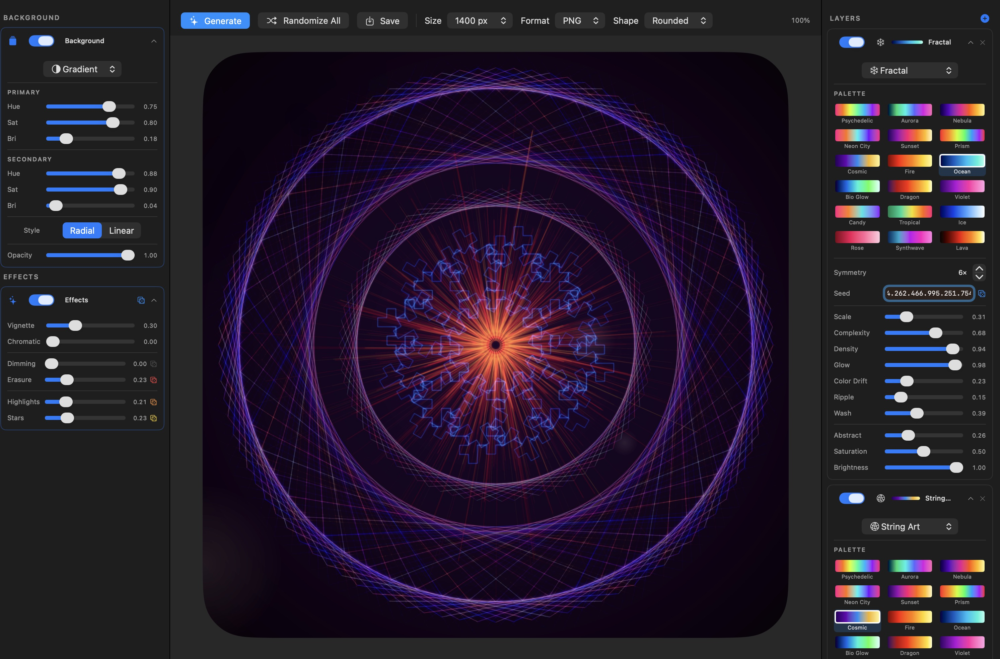

# Mandala Generator

Generates neon light-painting mandala images, with every parameter controllable in real time. A native macOS app and its Android port, sharing one settings format: files and favourites saved on one open on the other.

| | |
|---|---|
| [`mac/`](mac/README.md) | macOS app (Swift, SwiftUI, Core Image). Download from the [latest release](https://github.com/morja/mandala-generator/releases/latest). |
| [`android/`](android/README.md) | Android app (Kotlin, Jetpack Compose), its renderer as a plain Kotlin module, a command-line tool and parity tests against the macOS renderer. |
| [`docs/`](docs/adr/README.md) | Decisions (ADRs), approvals and reports for both apps. |

New features are built in the macOS app first and then ported. Rules for contributors and agents: [AGENTS.md](AGENTS.md).

## License

Copyright (C) 2026 Mathis Koblin

This program is free software: you can redistribute it and/or modify it under the terms of the GNU General Public License as published by the Free Software Foundation, version 3 (see `LICENSE`).

Additional permission under GNU GPL version 3 section 7: If you modify this Program, or any covered work, by linking or combining it with the Google Play Billing Library or with the system and platform libraries of Android, macOS or iOS (or modified versions of those libraries), containing parts covered by the terms of their own licences, the licensors of this Program grant you additional permission to convey the resulting work. You may also convey the Program through app stores (such as Google Play and the Apple App Store) whose terms of service add restrictions on use or copying.

Contributions are accepted under the same terms. See [ADR-0008](docs/adr/0008-open-source-gpl.md).
