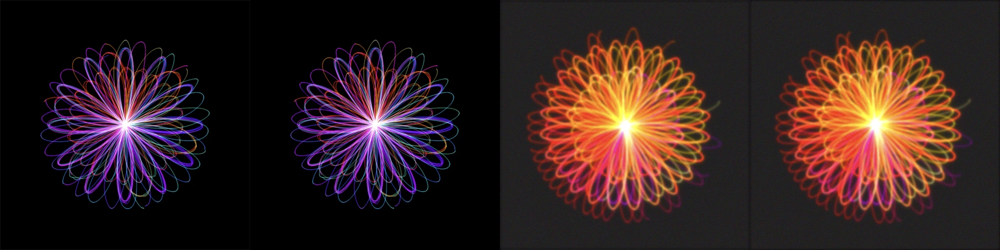

# POC-1 · Renderer port to Kotlin: results

19 October 2026. Question: can the macOS renderer run in plain Kotlin with the same look, and is it fast and small enough for a phone?

## What was built

- `core`: settings model and JSON (compatible with the Mac files), the xorshift RNG (bit-identical), the 18 palettes, the additive pixel buffer with Wu lines and tone map, five styles (Spirograph, Rose Curves, Hypocycloid, Phyllotaxis, Wave Interference), the per-layer chain (glow, wash, painted effect, colour grade, rotation, opacity, blend modes), the solid background and the final Lanczos downscale. Core Image steps are rebuilt on the CPU, including its Display P3 working space and 8-bit hand-over between steps.
- `cli`: `mandala render <settings.json> <out.png>` and `mandala compare`.
- `tools/reference-renderer`: builds the macOS renderer as a command-line tool, for reference images.

Not ported yet: the other 33 styles, background types other than solid colour, the effects layer, text, graffiti and drawing layers. The renderer reports these as warnings.

## Look: matches

| Fixture | PSNR | Mean error |
|---|---|---|
| spirograph-basic | 58.5 dB | 0.07 /255 |
| phyllotaxis-solid-background | 57.7 dB | 0.10 /255 |
| rose-ripple | 56.1 dB | 0.10 /255 |
| hypocycloid-rotated-wash | 47.3 dB | 0.33 /255 |
| wave-two-layers (Add blend) | 36.4 dB | 2.0 /255 |
| painted-default (abstract 0.3) | 27.2 dB | 2.9 /255 |
| painted-heavy (abstract 0.8) | 21.6 dB | 13.3 /255 |

Above about 40 dB the difference is invisible. The two lower groups have known causes (ADR-0004): Core Image's over-range handling with Add, and Apple's own turbulence noise. Side by side, the painted images have the same character.

## Speed: comparable to the Mac

MacBook (12 cores), JVM 21, single layer unless noted:

| Fixture | Size | macOS (Swift + Core Image) | Kotlin (4 threads) |
|---|---|---|---|
| spirograph-basic | 1024 | 1.0 s | 1.1 s |
| spirograph-basic | 2048 | 2.4 s | 2.9 s |
| wave-two-layers (2 layers) | 1024 | 2.8 s | 1.9 s |
| painted-heavy | 1024 | 0.8 s | 1.3 s |
| painted-heavy | 2048 | 2.0 s | 4.5 s |

Phone CPUs are roughly 2–4× slower than this Mac. A 512 px preview of a typical layer would take about 1–3 s on a phone; that is acceptable with a debounce, a progress indicator and a smaller first preview.

## Memory: the real problem

A 1:1 port needs far more memory than an Android app gets (typically 256–512 MB with `largeHeap`):

| Case | Result |
|---|---|
| wave-two-layers, 512 px, heap limit 512 MB | works (peak about 490 MB) |
| wave-two-layers, 512 px, heap limit 256 MB | out of memory |
| wave-two-layers, 1024 px, heap limit 512 MB | out of memory |
| wave-two-layers, 2048 px, 12 threads, heap limit 3 GB | out of memory |

Causes, all inherited from the macOS design:
1. Rendering at twice the output size (4× the pixels).
2. Each layer is drawn into a buffer enlarged to the full radius (up to 1.44 × that size) even without rotation.
3. One full-size float buffer per drawing thread.
4. Every filter step creates new full-size float copies (12 bytes per pixel), although the values between steps are only 8 bit.

## Conclusion and next step

The port is feasible: the look matches, the speed is fine. Before an Android app, the renderer needs a memory pass, without changing the look:

- keep images between steps as 8-bit (4 bytes per pixel instead of 12; exact, since the Mac quantises there anyway);
- enlarge the layer buffer only when the layer is rotated;
- draw with fewer sub-buffers (or row bands) and run filters in place or in tiles;
- on the phone, allow 1× supersampling for the preview.

Target: a 1024 px export of two layers under 256 MB of heap, checked by a test with a fixed heap limit. Then the Android app shell (Compose canvas, layer list, export) and the remaining styles.

## Found in the macOS app

`executeTasksParallel` in `MandalaRenderer.swift` splits the curves into `count / cores` chunks and never draws the remainder. Depending on the Mac, up to `cores − 1` curves per layer are missing, so the same settings can give slightly different images on different Macs. Fix: let the last chunk run to `tasks.count`.
