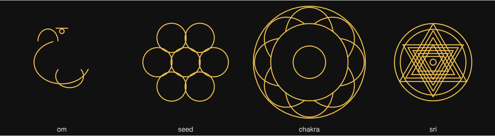
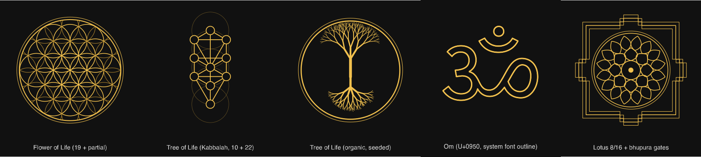

# RES-1 · Mandala motifs: Tree of Life, Flower of Life, Om and more

Research, 20 October 2026. Question from Mathis: how could the Android and macOS apps gain motifs that lean more towards classic mandalas, such as the Tree of Life, the Flower of Life and the Om sign?

Nothing has been built. The sketches below are throwaway SVGs made for this report, not renderer code.

## 1. What both apps have today

| Where | What | State |
|---|---|---|
| Style **Symbols** (`SymbolStyles.kt`, Swift `drawSymbolsLayers`) | Rings of 20 small symbols with one in the centre: heart, peace, infinity, Eye of Providence, yin-yang, crescent, Star of David, pentagram, ankh, **Om (#9)**, **chakra (#10)**, **"Flower of Life" (#11)**, Dharma wheel, Merkaba, triquetra, ouroboros, triskelion, Vesica Piscis, hamsa, **Sri Yantra (#19)** | Rough line sketches; see below |
| Style **Sacred Geometry** (`PatternStyles.sacredGeometry`) | Seed of Life (7 or 13 circles), nested polygons, Metatron lines between the circle centres | Correct and good looking |
| **Text layer** | Any text, centred, with glow, shadow and cloud | Can show `ॐ` today (see 4.3) |

Findings on the existing symbols:

- **Om (#9)** is five loose curves and is not recognisable as Om.
- **"Flower of Life" (#11)** is seven circles of radius 0.52 at distance 1, so they barely touch. The Seed of Life needs radius = distance; the Flower of Life has 19 circles.
- **Sri Yantra (#19)** is four upward and five downward equilateral triangles, concentric. The real yantra has nine triangles of different heights whose lines meet in exact triple points, 43 small triangles, lotus rings and a square frame with gates.
- These shapes cannot simply be corrected: favourites saved on the Mac would change their look, and ADR-0004 requires parity with the Mac. Better motifs need new names (a new style, a new layer or new symbol numbers), not edits to the old ones.

## 2. Candidate motifs

*From left: Flower of Life, Kabbalistic Tree of Life, organic Tree of Life, Om from a system font, lotus rings with a square gate frame (bhupura).*

| Motif | Construction | Fits as | Effort |
|---|---|---|---|
| **Flower of Life family**: Seed (7), Flower (19, clipped by a double ring), Fruit (13), Egg, Metatron's Cube | Circles on a hexagonal lattice, radius = spacing; Metatron's Cube = lines between the 13 Fruit centres. Pure geometry, exact | Style (variant setting) and emblem | Small |
| **Tree of Life, Kabbalah**: 10 sefirot, 22 paths | Sefirot sit on the lattice of four stacked Flower circles (three pillars); the 22 paths are a fixed list. Sources agree on the layout but give no authoritative coordinates; the lattice version in the sketch is the common one | Emblem | Small |
| **Tree of Life, organic** (the Celtic "Lebensbaum" in a circle, the meaning most people in Germany will expect) | Seeded recursive branching, crown upwards and roots downwards, clipped to a ring, branch width tapering. Space colonisation (Runions et al. 2007) gives more natural crowns but costs more | Emblem; small copies in a ring | Medium |
| **Om** | A clean outline as a closed path (Bézier curves flattened to polylines in core). Either drawn by us, or taken from an OFL font's glyph (see section 5) | Emblem; small copies in rings | Small to medium (the drawing is the work) |
| **Lotus (padma)** | Rings of pointed petals, usually 8 inside and 16 outside, optional double petals; the most typical element of Hindu and Buddhist mandalas | Style | Small to medium |
| **Bhupura** | Square frame with a T-shaped gate on each side, in three nested lines; the outer frame of yantras and Tibetan mandalas | Frame option or style | Small |
| **Sri Yantra, exact** | Nine triangles with the concurrency conditions; needs a numerical solve once (literature: Comptes Rendus Math. 2021, texample.net), then fixed coordinates; plus lotus rings and bhupura | Emblem | Medium |
| **Ornament bands** (the colouring-book mandala: rings of petals, scallops, teardrops, beads, dots, zigzags) | Each band is one motif repeated around a ring; a seeded sequence of bands from the centre out | Style | Medium to large, but the biggest step "towards mandala" |
| Smaller additions | Chakra set (correct petal counts 4, 6, 10, 12, 16, 2), unalome, endless knot, correct Seed of Life | Symbols or emblem | Small each |

My assessment: the single motifs (Om, Tree of Life) give the app a recognisable "spiritual" look, but what makes an image read as a *mandala* is the structure: centre, lotus rings, ornament bands, square frame with gates. Lotus, bhupura and ornament bands do more for that than more symbols in the Symbols style.

## 3. Where it fits in the apps

Three ways, and the motifs above split naturally between the first two:

**A. New styles in the style layers** (Flower of Life family, Lotus, Ornament bands, Bhupura). Symmetry, palette, glow, ripple and blending come for free. Needs a new style name in both apps; an older Mac version reads an unknown style as `mixed` and silently draws something else. Variants (Seed, Flower, Fruit, Metatron) need one new field per style layer.

**B. A new emblem layer** (Om, both Trees of Life, Sri Yantra, single Flower of Life): one motif in the centre, with size, line weight, optional fill, glow, colour from the palette, and opacity, composed like the text layer. These motifs are not radially symmetric and look wrong when repeated and rotated by the symmetry. An older Mac version ignores the unknown field, so the emblem is missing there but nothing else changes.

**C. More symbols in the Symbols style.** Cheapest, but the style picks symbols at random with `% 20`; adding numbers changes which symbols existing favourites show unless the old selection is kept for old files. Only worth it for small additions.

Recommendation: A for Flower of Life, Lotus, Bhupura and later Ornament bands; B for Om, Tree of Life and Sri Yantra.

## 4. Building it for both apps

### 4.1 Which app leads

Today the Mac renderer is the reference and Android ports it (ADR-0004). For new motifs there is no reference yet. Options:

1. **Mac first, then port** as before. Keeps ADR-0004 unchanged; the Swift renderer is one 6,000-line file, and every motif is written twice.
2. **Kotlin first, Swift ports it**, with the parity test running the other way. Needs a change to ADR-0004.
3. **Motifs as shared data**, recommended for everything that is fixed geometry: Om outline, both Kabbalah and lattice coordinates, Sri Yantra coordinates, bhupura, petal shapes. One JSON file of paths in unit space, read by both renderers; only the drawing code (a few dozen lines: transform, flatten, add lines) exists twice. Generative motifs (organic tree, ornament bands) stay code in both apps, with a fixture and a parity threshold as now.

Option 3 plus 1 or 2 for the generative parts keeps the two apps from drifting. It is a new decision and needs an ADR and your approval (possibly a shared folder or a small shared repository for the data file).

### 4.2 Settings JSON

New fields must go into the Swift model and `Model.kt` together (ADR-0003). Suggested shape, to be settled in the ADR: `layers[].style` gains `flowerOfLife`, `lotus`, `bhupura`, `ornament`; `layers[].variant` (string, default per style); a new top-level `emblemLayer` like `textLayer`. Older app versions degrade as described in section 3.

### 4.3 Quick test without code

The text layer can show `ॐ` (U+0950) today: Android draws it with its Devanagari system font (Noto), the Mac with Kohinoor Devanagari. Set the text to `ॐ`, author off, font size around 0.3, glow on. That is a quick way to judge whether Om in the centre is wanted at all, before anything is built. Limits: it is filled text, not line art in the palette colours, and it looks different on each platform.

## 5. Rights and cultural care

- **Om is a sacred sign in Hinduism (and Buddhism, Jainism).** In an art app it is common and generally accepted. Complaints from Hindu groups concern placement on feet, floors, shoes and underwear, and casual commercial use. For the app: draw it upright and unmirrored, keep ripple and painted distortion off the emblem, do not cut it at the image edge, and do not rotate it around the ring the way the Symbols style rotates its symbols. Users choose what they export; the app need not do more.
- **Kabbalistic Tree of Life and Sri Yantra** are religious diagrams too, but rarely a source of complaint. The same upright, undistorted rule fits.
- **Shapes:** Flower of Life, Kabbalah layout, lotus, bhupura and Sri Yantra are traditional geometry and free to use. Coordinates from papers are mathematical facts, but computing them ourselves is cleaner.
- **Om outline:** do not trace pictures from the web. Either draw our own outline from the standard letterform, or convert a glyph from an OFL-licensed font (Noto Sans Devanagari, Hind, Yantramanav) to path data. The OFL allows modification and redistribution; whether shipped glyph outlines count as distributing the font is not settled, so include the OFL notice in the app's licences if we do. An own outline avoids the question.
- **No new packages are needed** for any of this; all motifs are lines and paths that the existing renderer draws.

## 6. Suggested order

1. Try `ॐ` in the text layer (no code) and decide whether emblems are wanted.
2. ADR: emblem layer, new style names, shared motif data, which app leads.
3. Flower of Life style with variants: small, exact, a fast win in both apps.
4. Emblem layer with Om and both Trees of Life.
5. Lotus and bhupura (as style and as an emblem frame).
6. Ornament bands, then the exact Sri Yantra.

## 7. Decisions

Mathis, 20 October 2026:

- **Mac first**, then port to Kotlin, so he can try new motifs on the Mac first.
- **Mac favourites may change** where that buys a better, clearer app. Existing features stay; only what does not work (such as the Om, Flower of Life and Sri Yantra drawings in Symbols) may be redrawn. ADR-0004 parity then follows the new Mac look.
- **Tree of Life = the organic tree in a circle.** The Kabbalah diagram is not wanted for now.
- **Om:** our own outline, usable in several renderings. Not via the text layer.
- **Emblem layer:** likely yes, because it needs other controls than a style layer.
- **Shared motif data:** undecided; recommendation in the reply was to copy fixed outlines (such as the Om path) as constants into both renderers instead of a shared data folder.

## Sources

- Flower of Life, Fruit of Life, Metatron's Cube, Tree of Life overlay (popular sources, no exact coordinates): [mysticryst.com](https://mysticryst.com/blogs/the-mystic-journal/kabbalah-sacred-geometry-metatrons-cube-the-flower-of-life-the-tree), [pardesco.com](https://pardesco.com/blogs/news/tree-of-life), [satyori.com](https://satyori.com/symbols/seed-of-life/), [psyche.com](https://psyche.com/psyche/tree/tree_intro.html)
- Sri Yantra construction: [Comptes Rendus Mathématique 2021](https://www.numdam.org/articles/10.5802/crmath.163/), [texample.net](https://texample.net/sri-yantra/), [Pustynski, Indian Journal of History of Science](https://cahc.jainuniversity.ac.in/assets/ijhs/Vol49_3_5_Pustynski.pdf), [satyori.com](https://satyori.com/sacred-geometry/sri-yantra/)
- Mandala structure (rings, lotus, square palace with T-gates): [Wikipedia: Mandala](https://en.wikipedia.org/wiki/Mandala), [Brown University: symbols in Tibetan art](https://library.brown.edu/cds/BuddhistTempleArt/symbols.html), [pardesco.com mandala guide](https://pardesco.com/blogs/news/the-complete-guide-to-mandalas)
- Tree generation: [Runions, Lane, Prusinkiewicz 2007, space colonisation](https://www.algorithmicbotany.org/papers/colonization.egwnp2007.pdf)
- Om and respectful use: [Hindu American Foundation](https://www.hinduamerican.org/?p=2408), [Religion News Service](https://religionnews.com/2020/01/02/namaste-corporate-america-when-retail-and-reverence-collide/), [hindupad.com](https://hindupad.com/amazon-apologize-withdraw-lord-ganesha-stockings-om-flip-flops/)
- Font licence: [OFL FAQ](https://ctan.csail.mit.edu/fonts/gentium/Gentium/OFL-FAQ.txt), [Noto Sans licence](https://www.fontsquirrel.com/license/noto-sans)
- Other mandala apps (sacred geometry and ornament stickers as a common feature): [freeappsforme.com overview](https://freeappsforme.com/mandala-drawing-apps/), [Mandala Maker](https://apps.apple.com/us/app/-/id1198232048)
