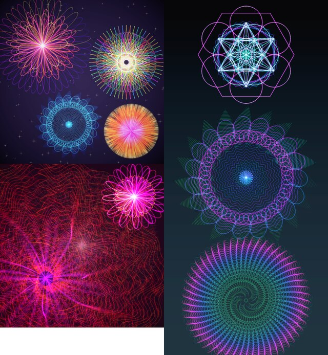

# RES-2 · Moving layers on their own

Research, 20 October 2026. Question from Mathis: what would it take to move each layer on its own, not only in the export but in the mandala itself, so that many elements can sit in different places?

A small prototype exists on the local branch `spike/layer-offsets` (renderer only, not for merging). Decided by Mathis on 20 October 2026, everything as recommended; see the end and [ADR-0011](adr/0011-layer-positions.md).

## Short answer

- **Yes, and in the mandala itself, not only in the export.** Each layer gets a position next to the size (`scale`) and turn (`rotation`) it already has. It is saved with the settings, so it shows in the editor, in favourites, in the history and on the Mac.
- **The renderer is the smallest part.** Since PLAN-2 step 1 every layer is drawn around a centre of its own, so the prototype needed about twenty lines. Memory and time per layer stay as they are.
- **The real work is the Mac app (Mac first, ADR-0008) and moving layers by hand in the editor.** On a phone a full preview cannot be redrawn while a finger moves, so dragging needs either an outline or a cache of the layer images.

Left top: four small mandalas spread over a radial gradient with stars. Left bottom: a large mandala off the centre and a small one opposite. Right: three mandalas stacked on a 9:19.5 portrait canvas. All rendered by the prototype with the CLI.

## 1. What it means

| Element | Today | Proposed |
|---|---|---|
| Mandala layer | centred; `scale` 0.1–1.2, `rotation` | plus `offsetX`, `offsetY`: where its centre sits, in fractions of the mandala's square from its centre (right and down positive); 0 = centred as today |
| Emblem | centred; `size`, `rotation` | the same two fields (recommended) |
| Text | `offsetY` (Mac also `offsetX`) | unchanged |
| Hand layers (lines, spray) | drawn around the centre with their symmetry | unchanged |
| Background, effects layer | canvas; centred backgrounds at the mandala's centre (ADR-0010) | unchanged: they follow the centre of the whole composition |

The export framing (ADR-0010) stays on top: it moves and zooms the whole composition. Layer positions are part of the mandala; the framing is part of one saved image.

## 2. In the export only, or in the mandala?

- **Only in the export** (per-layer framing in the save sheet): not visible while editing, not in favourites, lost on the Mac. It would feel like a hidden second editor. Not recommended.
- **In the mandala** (settings fields): visible and editable everywhere, saved with favourites, shared with the Mac through the settings JSON. This needs the Mac app to know the fields first (ADR-0003, ADR-0008). Recommended.

## 3. What the prototype shows

- **Renderer change:** per layer the centre moves by the offset; the viewport logic from PLAN-2 does the rest (only the part that reaches the canvas is drawn). Centred layers take the old path, so existing images stay byte-identical.
- **One catch, fixed in the prototype:** a centred layer is drawn in a square just large enough for the canvas. Moved, that square's edge became a hard visible line. Moved layers therefore get their full square (like rotated layers today), cut to the canvas plus effect margin.
- **Memory:** a moved layer covers at most the canvas plus its margin, the same bound as a zoomed-in layer, which `MemoryBudgetTest` already checks (178 MB for the tallest Pro portrait). A test case with moved layers would be added.
- **Time:** the same per layer; lines outside the canvas are rejected early.

## 4. Work on the Mac (first, by the rule)

- `StyleLayer` gains `offsetX`, `offsetY`, decoded with default 0, so older favourites look as before and older Mac versions show such a mandala centred.
- Renderer: the Mac already draws every layer into a buffer large enough for its full radius and then cuts the middle out (`cropCenter`). Cutting at the offset instead of the middle is the whole change; parts beyond the buffer are black, as on Android.
- UI: X and Y sliders per layer, and dragging on the canvas.
- Parity: two or three fixtures with moved layers and their reference images, so Android is measured against the Mac as with every feature (ADR-0004).

## 5. Work on Android

- Core: the two fields (JSON names as on the Mac), the renderer change from the prototype, parity fixtures, a `MemoryBudgetTest` case.
- Editor, simple part: a "Position" group per layer with X and Y sliders and "Centre". The size slider is already there.
- Editor, by hand: a "Move" mode for the canvas like the drawing tools: drag moves the selected layer, pinch changes its size, two fingers turn it.
- Feedback while dragging. A full preview takes too long to follow a finger (QA-1: 10 to 30 s for heavy favourites in the emulator; real phones are faster, but nowhere near live). Two ways:
  - **Outline:** while the finger moves, a circle of the layer's size and its centre are drawn over the old preview; the preview is redrawn when the finger lifts. Simple; recommended to start with.
  - **Layer cache:** the preview keeps each layer's finished image; moving a layer only blends the images again (milliseconds), with the effects layer left out while dragging. Live, but a change in the renderer's interface. Worth it only if the outline feels too indirect.
- The editor canvas stays the mandala's square. Parts moved outside it are cut there; the export framing can zoom out to show them.

## 6. "Many elements in different places"

- The apps allow five layers (the Mac's limit). Memory does not grow with more layers, because they are drawn one after another; time does, roughly one full layer each.
- Ways to more elements, to decide after trying positions:
  - **Raise the limit** (say to eight): a Mac decision; preview time on phones to be checked.
  - **Copies of a layer:** one layer drawn once and placed several times. Drawing once and blending N times is cheap, for example small mandalas spread as a pattern. A new concept in the settings, again Mac first.
  - **Several emblems:** the same idea for the emblem layer.

## 7. Order of work

1. Mac: fields, cutting at the offset, sliders, fixtures and reference images.
2. Android core: fields, renderer (prototype), parity, memory test.
3. Android editor: "Position" group, then the "Move" mode with the outline.
4. Later, if wanted: layer cache for live dragging; more elements or copies.

## Questions for Mathis

1. In the mandala, saved with the settings (recommended), or only in the export?
2. Pro or free? Moving the mandala in the export is Pro (ADR-0010). Making layer positions Pro as well fits that and adds to the reason to buy; favourites with moved layers would still render for everyone, only editing positions would need Pro. My recommendation: Pro, with the "Position" group visible and a Pro mark, like the framing.
3. The emblem's position as well (recommended)?
4. Mac first, as the rule says (recommended; the Mac part is small), or Android first as an exception?
5. More elements (higher limit, copies, several emblems): decide after trying positions?

## Decisions (20 October 2026, Mathis: "everything as recommended")

1. Positions are saved in the mandala, not only set in the export.
2. Editing positions is Pro.
3. The emblem gets a position as well.
4. Mac first.
5. More elements are decided after trying positions.

Recorded in [ADR-0011](adr/0011-layer-positions.md).
