# TUNE-1 · Palettes, sliders and the dice

22 October 2026. Review of every palette and every slider in the Android app, so that a user gets good results quickly. About 1,200 renders with the command-line renderer (it draws exactly what the app draws), each slider swept over its range at min, 25 %, 50 %, 75 % and max on several styles and favourites. Analysis only; nothing is changed yet. Almost all findings apply to the macOS app as well, because the code is the same.

Two constraints shape every proposal:

- **Saved settings must keep their look** (ADR-0003). Palette indices stay valid; a palette can be hidden from the picker, not deleted. Changing a renderer formula changes how existing favourites look, on both apps.
- **Mac first.** Renderer changes and shared ranges go into the macOS app first and are ported, with new parity references (ADR-0004).

## 1. Palettes

18 palettes, all fully saturated. Four pairs are almost indistinguishable in every test image (distance in OKLab, 32 samples per palette):

| Pair | Distance |
|---|---|
| 2 Nebula – 4 Sunset | 0.019 |
| 3 Neon City – 12 Candy | 0.027 |
| 0 Psychedelic – 5 Prism | 0.031 |
| 8 Ocean – 9 Bio Glow | 0.046 |

Also weak: 10 Dragon (darkest, reads as Violet), 6 Cosmic (pale, turns lavender), 15 Synthwave (between Aurora and Violet), 8 Ocean (between Bio Glow and Ice).

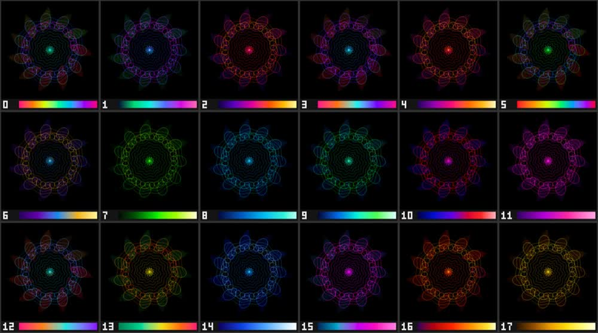

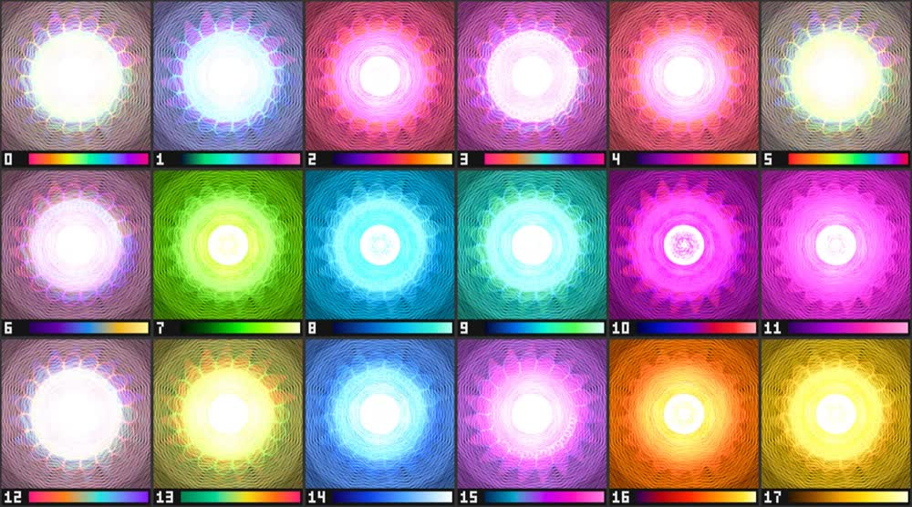

**Proposal:** offer 11, in this order (colourful first, then once round the colour wheel): Psychedelic, Neon City, Tropical, Sunset, Lava, Gold, Toxic, Bio Glow, Ice, Aurora, Violet. Hide Prism, Candy, Nebula, Ocean, Synthwave, Dragon, Cosmic: they keep rendering in saved settings, and the picker shows a hidden palette as selected when a layer uses it. The dice and "add layer" (today `(last + 3) % 18`) draw only from the offered ones.

**Missing:** everything is neon. Worth adding (Mac first, needs approval): a neutral **Silver/Moon** (grey to warm white, elegant for emblems, line styles and prints) and an **Earth** palette (terracotta, ochre, olive, sage). A pastel palette would need testing first: additive glow on black turns pastels white quickly.

## 2. The dice

The dice ranges are the same on both apps (`Randomize.kt`, `AppState.swift`). About 4 in 20 throws come out blown out: a white disc, yellow over-saturation, pink mush.

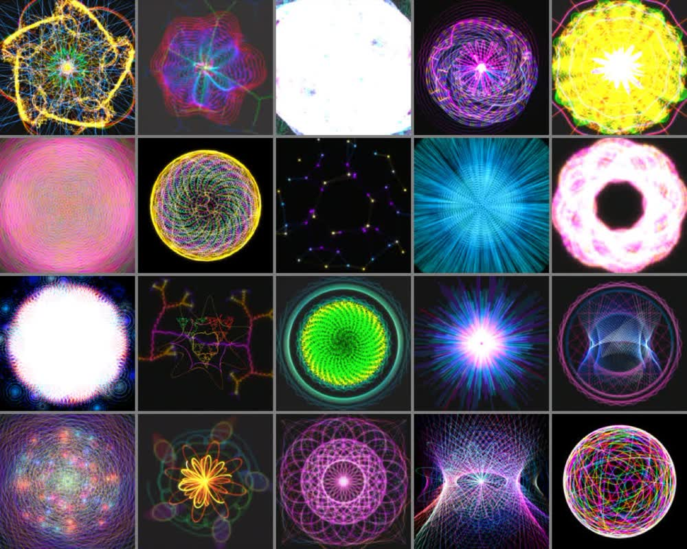

The main cause is **Wash**: the dice give every layer Wash 0–0.5, but Wash works like a switch (the whole jump happens between 0 and 0.05, see 3.10), and Android has no slider to turn it off. Second cause: Painted above 0.5 lifts everything towards white.

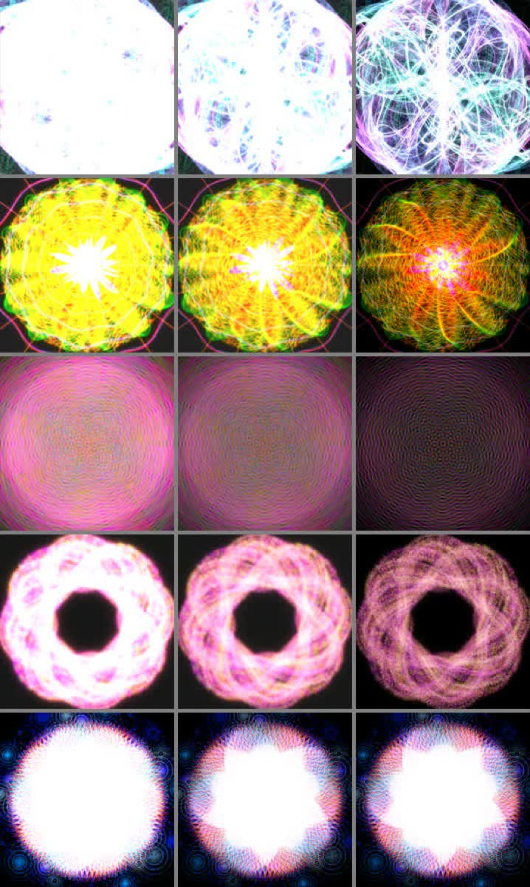

**Proposal:** Wash 0; Painted 0.1–0.5; Brightness 0.3–0.6; Symmetry 3–8 (1 and 2 come up in a quarter of throws today and look lopsided for most styles); a little less Complexity and Density from the second layer on.

## 3. Mandala layer sliders

1. **Brightness** (gain 3 × value): 0–0.2 is black, dense styles burn out from 0.5–0.75. Usable range about 0.2–0.7. Proposal: slider range 0.15–0.85.
2. **Painted:** nothing happens from 0 to 0.4 (the strong part starts at 0.3, the default sits at the end of the dead zone); at 1.0 the black background turns grey. Proposal: map the slider to 0.3–0.85.
3. **Complexity:** at 0, four of six styles are completely black (line width is multiplied by it, as in Swift); for Deep Nebula and Floral it changes little. Proposal: minimum 0.15.
4. **Density:** fine where it works; no effect on Spirograph and String Art. Proposal: hide it for styles where it does nothing.
5. **Ripple:** clear only on Flow Field, subtle on Floral and Spirograph, none elsewhere. Proposal: hide it per style like Density.
6. **Glow:** little happens below 0.5. Optional: a square-root mapping.
7. **Colour drift, Saturation, Opacity:** fine.
8. **Scale:** 0.1 is tiny. Proposal: 0.2–1.2. The Mac slider goes 0–1, so its first tenth does nothing and 1.0–1.2 cannot be reached; give it the same range.
9. **Symmetry 1–8** (Mac the same): fine. Higher values would need brightness normalisation in the renderer; not worth it now.
10. **Wash** (no slider on Android): a switch, not a slider, because only the blur radius scales with it, not its strength.

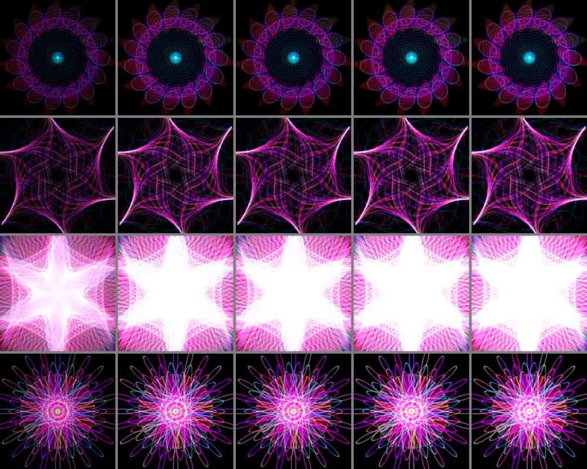

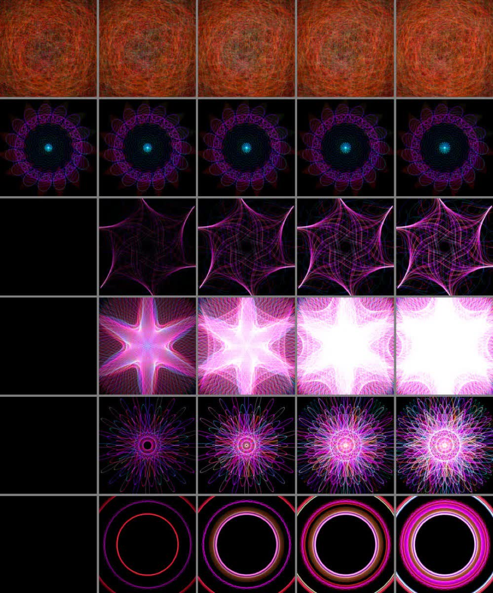

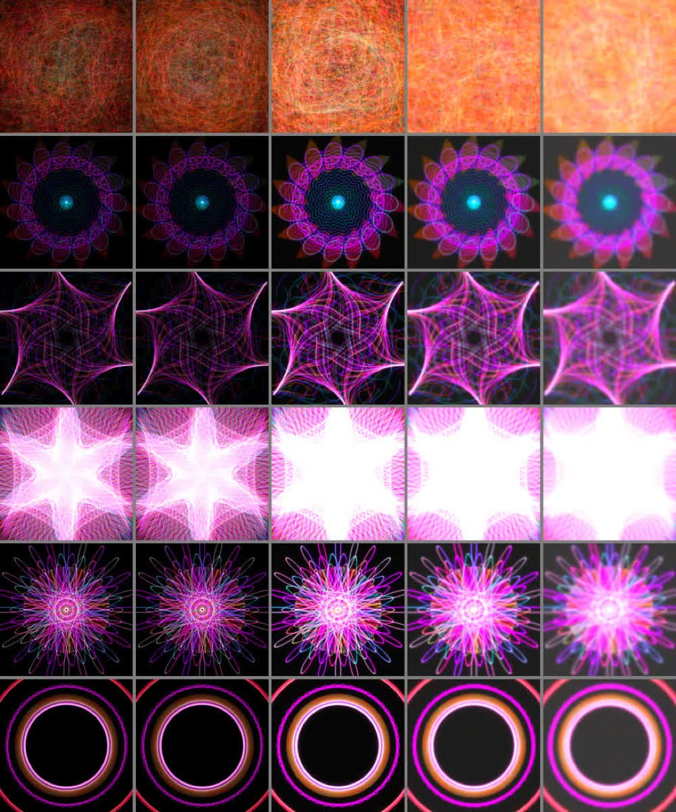

## 4. Effects

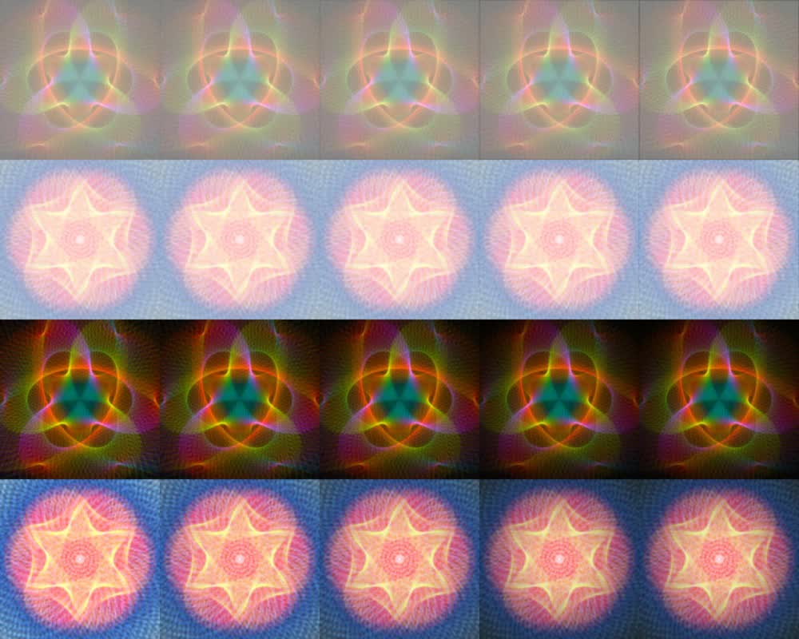

1. **Relief is broken:** any value above 0, even 0.01, turns the whole image grey; above that the slider only adds ridges. Proposal: fix the blend so flat areas stay neutral, or hide it until then.
2. **Chromatic** leaves a green stripe at the left and right edges (it samples black outside the image) and is hard to see otherwise. Proposal: clamp at the edges; optionally make it radial.
3. **Vignette** is too weak: the default 0.3 is invisible, because the radius grows with the strength. Proposal: fixed radius and about 1.5 × the strength.
4. **Bloom** is barely visible on dark images. Proposal: double the gain.
5. **Grain** is hardly visible and vanishes in large exports (per-pixel noise). Proposal: about twice as strong and scaled with the image size.
6. **Glitter** does nothing up to 0.25 and is garish confetti at 1.0. Proposal: map the slider to 0.1–0.6.
7. **Wash and Fade** do almost the same (a lift towards white; Wash also desaturates). Proposal: one slider "Fade".
8. **Highlights, Dimming, Erasure** look like light leaks, blotches and burn holes. Proposal: move them, with Relief and Chromatic, into a "More" section.
9. **Sepia, Clarity, Stars, Brightness, Contrast** work well and give quick results.

Proposed order: *Light* Brightness, Contrast, Vignette, Bloom · *Tone* Sepia, Fade · *Texture* Clarity, Grain · *Sparkle* Stars, Glitter · *More* the rest.

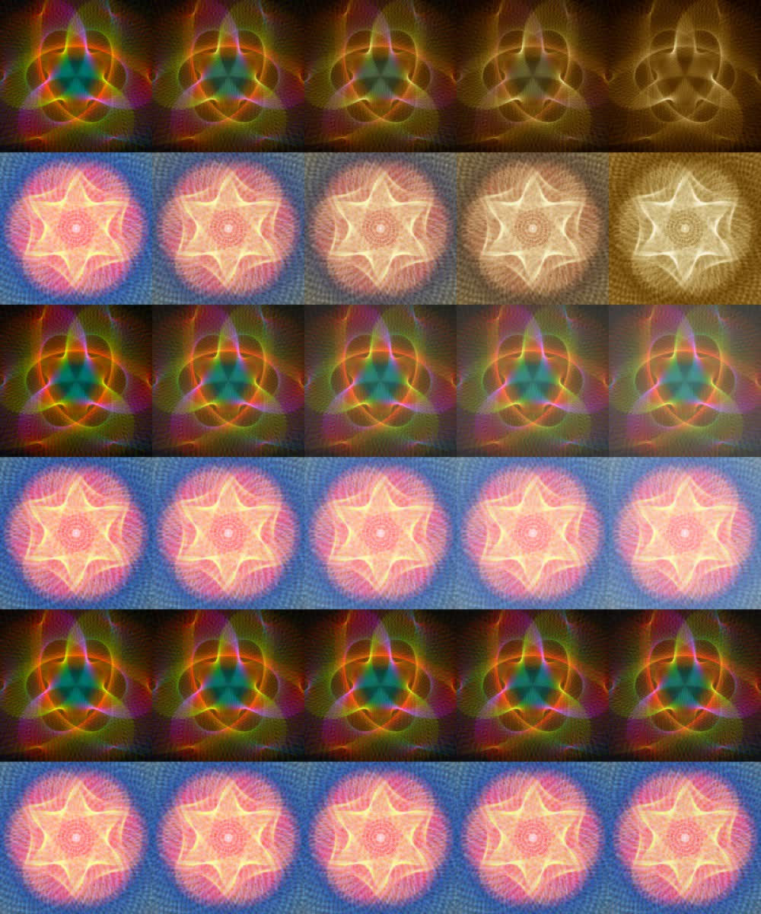

## 5. Background

1. The default colours are so dark (brightness 0.18 and 0.04) that Colour, Gradient and Grain look the same. Proposal: about 0.35 and 0.08.
2. **Sunburst has a seam** on the left horizontal axis, because the number of rays is not a whole number. Proposal: round it.
3. Above a brightness of about 0.6 a colour background drowns the mandala (lines are added with Screen). Proposal: limit the background brightness to about 0.6.
4. The **Grain** type disappears in large exports and only lifts the colour. Proposal: hide it (the effects layer has grain).

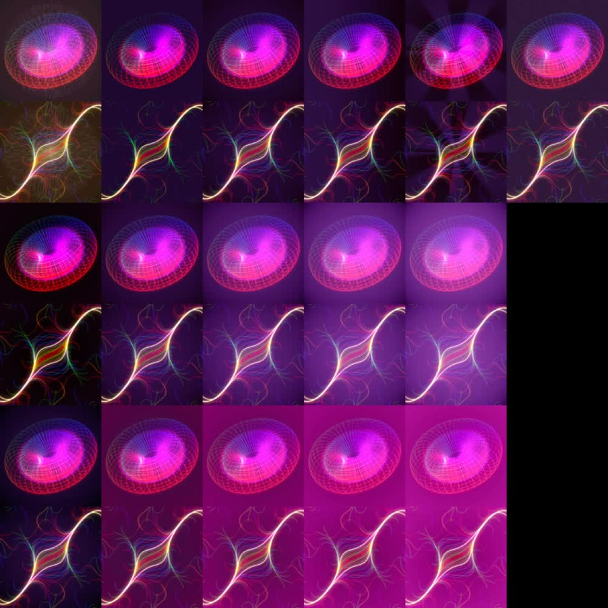

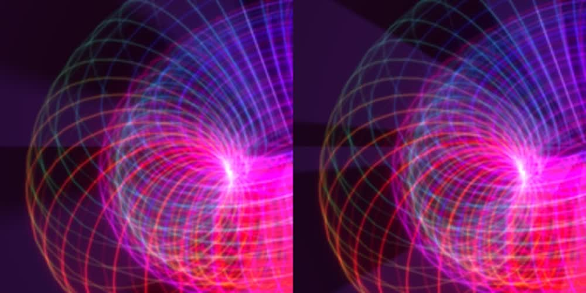

## 6. Emblem

1. **Glow makes a dark halo** with the default blend Normal instead of light, and most of the change happens between 0 and 0.25. Proposal: fix the glow outside the shape and use a gentler curve.
2. **Size:** at 1.0 the ring is clipped, and the Gates and Lotus Ring frames reach the edge at about 0.75. Proposal: 0.2–0.9.
3. **Weight** with Line rendering is almost invisible at 0. Proposal: map to 0.1–1.
4. Position, Spread, Organic, Branches and all frames: fine. Outline on Flower of Life turns into a dense bright mass.

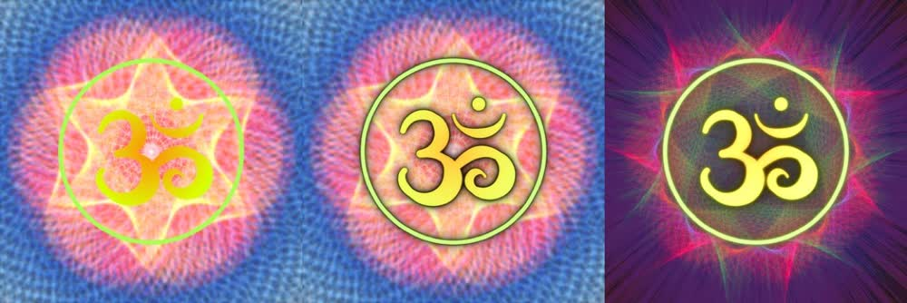

## 7. Text

1. **Size:** Android 0.02–0.2, Mac 0.02–0.105. Above about 0.13 a quote runs off the canvas. Proposal: 0.03–0.12.
2. **Width** below 0.3 gives one word per line. Proposal: 0.4–1.0.
3. **Glow is invisible** even at 1.0 (Mac the same). Proposal: about 3 × stronger or wider.
4. **Brightness:** Android 0–1.5, Mac 0–2; the starter favourites store 2.0, outside the Android slider. Proposal: 0–2 as on the Mac.
5. **Cloud** is the best lever for readability; Cloud size above 0.7 darkens most of the mandala. Proposal: 0–0.7. Shadow has only four visible steps; a continuous strength would be better.

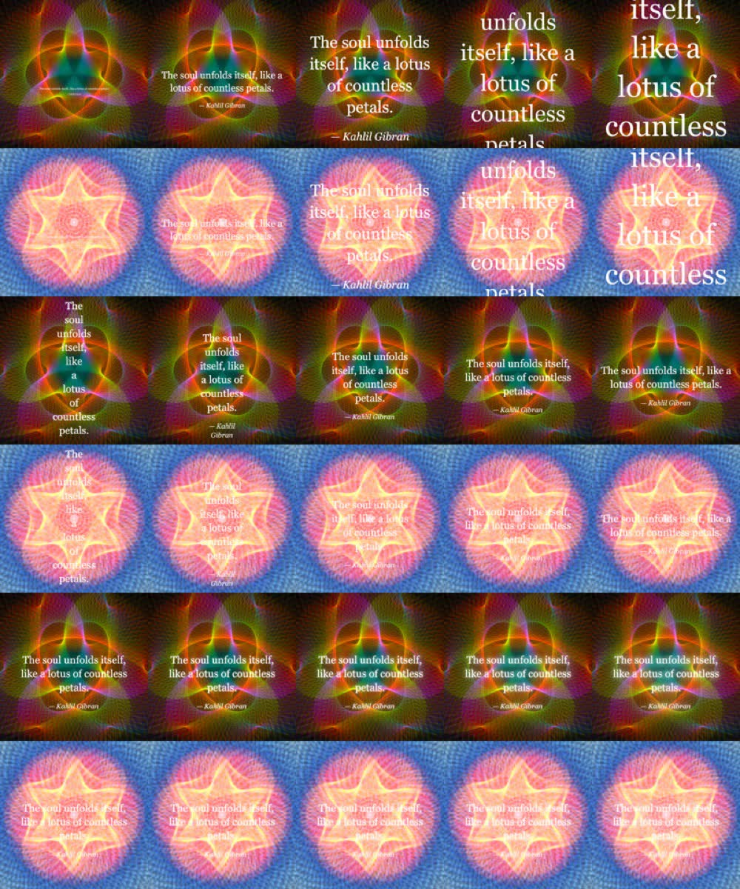

## 8. Side findings

- Starter favourites 7 and 8 use palette indices 18 and 19, Mathis' own Mac palettes; Android silently takes the last built-in palette (Gold). For favourite 7 that is close, for 8 it is a visible change.

## 9. Suggested order

1. **Palettes and dice** (Android picker and dice; dice ranges also on the Mac): the biggest felt improvement, no change to saved images.
2. **Fixes** in both renderers: Relief, Chromatic edge, Sunburst seam, emblem glow, text glow, Wash as a real slider. These change the look of saved settings that use them; new parity references.
3. **Slider ranges** (UI only, values in the JSON unchanged): Brightness, Painted, Complexity, Scale, emblem Size and Weight, text Size, Width, Brightness and Cloud size, Glitter.
4. **Tidier panels:** effects order with "More", Fade and Wash merged, Density and Ripple hidden per style, brighter background defaults, Grain type hidden.
5. **New palettes** Silver and Earth, Mac first.

## 10. What was changed: UI

22 October 2026, branch `tune/ui`, both apps; renderers untouched, settings JSON unchanged (same fields, same decoder defaults). The rules live in one place per app: `Editing.kt` (Android) and `ControlChoices.swift` (macOS).

1. **Palettes:** the pickers (layer and emblem) offer the 11 palettes of section 1 in that order; on the Mac the custom palettes follow. A hidden palette in use still shows, as selected, at the end of the built-ins. The dice, "add layer" (three steps on in the offered order instead of `(last + 3) % 18`) and the Mac batch export draw only from the offered ones; the Mac emblem dice also from the custom ones, as before.
2. **Dice** (Android `Randomize.kt`, Mac `AppState.swift`): Wash 0, Painted 0.1–0.5, Brightness 0.3–0.6, Symmetry 3–8, Complexity and Density × 0.8 from the second layer on; the background dice no longer pick Grain. In 20 paired throws (same random draws, old and new ranges; rendered with the command-line renderer) the throws with more than 10 % near-white pixels went from 9 to 2. Both remaining ones contain Strange Attractor, a dense point cloud that still burns out at brightness 0.6.
3. **Slider ranges:** layer Brightness 0.15–0.85, Painted 0.25–0.85, Complexity 0.15–1, Scale 0.2–1.2 (Mac was 0–1); emblem Size 0.2–0.9, Weight 0.1–1; text Size 0.03–0.12, Width 0.4–1, Brightness 0–2, Cloud size 0–0.7, Glow 0–3; effects Vignette, Bloom and Grain 0–2, Glitter 0–0.6 (values up to 1 render exactly as before, see section 11). A saved value outside a range only puts the knob at the end: the value is shown and kept until that slider is moved. Pinching on Android follows the new layer Scale and emblem Size ranges but never pushes a saved value further out, and moving without zooming leaves it alone. The Mac text dice now stay within Size 0.04–0.12.
4. **Effects:** Light (Brightness, Contrast, Vignette, Bloom) · Tone (Sepia, Fade) · Texture (Clarity, Grain) · Sparkle (Stars, Glitter) · More, folded (Highlights, Dimming, Erasure, Relief, Relief angle, Chromatic). "Fade" sets the effects `wash` field; the old `fade` field gets an "Old fade" slider under More only in settings where it is above 0 (once shown it stays while the panel is open). The die in the Effects heading moves highlights, dimming, erasure, stars and glitter to new places (moved out of Sparkle on 24 October 2026), "Reset" beside it puts all effects back to the defaults. Since the same day Radial Mesh has its "Spokes" slider under Shape, the Shape heading carries a die that only rearranges the layer (new seed, same style and palette), and the Text tab has a die and a reset beside its switch like the Emblem tab. On the Mac "Local Contrast" is now "Clarity" as on Android.
5. **Density and Ripple** are hidden for styles that ignore them. Density: Spirograph, Rose Curves, Butterfly, Epitrochoid, Lissajous, Hypocycloid, Geometric, Sunburst, String Art. Ripple: Sacred Geometry, Sunburst, Star Burst, String Art, Strange Attractor, Constellation Web, Deep Nebula, Interference Bloom, Hyperboloid, Torus, Nautilus, Universe, Symbols. Ripple works on more styles than section 3 assumed (all curve styles, clearly on most). Found in the renderer code and checked by `StyleControlsTest`, which renders every style with a low and a high value and fails when the tables and the renderer disagree.
6. **Background:** switched on, or set to another type, while its colours are still the decoder defaults, it starts at brightness 0.35 and 0.08. The colour brightness sliders go 0–0.6. Grain is offered only while it is the current type.

Tests: `PickersAndRangesTest` (offered palettes and order, hidden palette shown, add-layer palettes, Grain, background start, defaults inside the ranges, pinch keeps saved values), `StyleControlsTest`, and dice ranges in `HistoryAndRandomizeTest`.

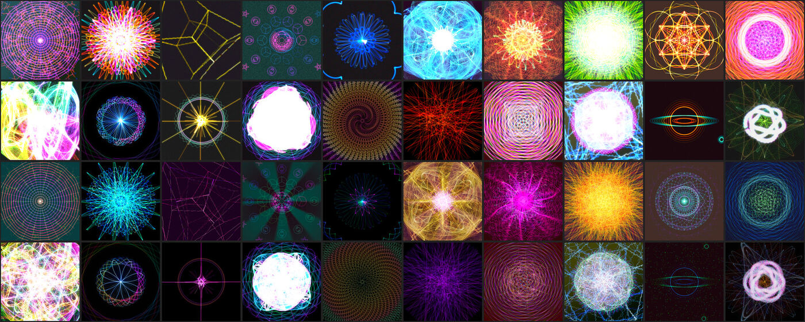

Still open: Silver and Earth palettes, and the Strange Attractor throws above (a style-specific brightness cap in the dice, or normalisation in the renderer).

## 11. What was changed: renderer

22 October 2026, branches `tune/renderer` and `review/palettes-sliders`. Principle (Mathis, after the first before/after renders): **saved settings render exactly as before**; more strength comes from sliders that go beyond the former maximum, never from a changed curve inside the former range. Changed in the macOS renderer first, then ported to the Kotlin core; details and parity thresholds in ADR-0004. Checked by rendering 138 saved settings (fixtures, starter and Mac favourites) with the old and the new command-line renderer at 384 px: 128 byte-identical, the rest are the three fixes below.

Fixes that change saved settings that use them:

1. **Relief:** the emboss convolves colour only and repeats the edge pixels, so flat areas stay neutral; 0.01 looks like the original and the slider adds ridges evenly. *Saved settings with relief* lose the grey veil. No starter favourite uses relief.
2. **Chromatic:** red and blue repeat the edge pixels instead of black; the coloured stripe at the left and right edges is gone, the rest is unchanged.
3. **Sunburst background:** a whole number of rays, which removes the seam on the left horizontal axis. Saved sunbursts get at most half a ray more or fewer (starter and Mac favourites with a sunburst: 49–62 dB, the rays shift slightly).

Same look up to 1, more above:

4. **Vignette** (slider 0–2): up to 1 as before (radius 0.4 + 0.6 × value, intensity 2.5 × value); above 1 the radius stays at 1 and only the intensity grows.
5. **Bloom** (slider 0–2): the former gain, linear beyond 1 (no clamp anywhere).
6. **Grain** (slider 0–2): the former amplitude, linear beyond 1. On the Mac grain did nothing at all before (the noise was transparent); it now works there as on Android, so Mac files with grain look different on the Mac only. Above 1024 px the grain cells grow with the image, so large exports keep the preview's grain; previews and images up to 1024 px are unchanged.
7. **Text glow** (slider 0–3): up to 1 as before. Above 1 the former glow stays at its value for 1 and its two wide passes add light screened on top, growing from nothing at 1 (with Multiply the former glow simply continues).
8. **Glitter:** the renderer is unchanged; the slider ends at 0.6, as above that it turns into garish confetti.

New choice:

9. **Emblem glow mode** (new field `glowMode`, both apps): "Shadow" is the original glow (a soft coloured halo that is dark with Normal blending); "Light" screens the blurred light of the emblem on top after it is blended, with strength following the square root of the glow and the reach starting at a third, so low values already show a soft halo. Saved settings without the field, and unknown values, decode as Shadow and render exactly as before; switching the emblem on, its dice and its reset start with Light. With Multiply the glow is always Shadow. Fixtures `emblem-glow-light` and `emblem-glow-shadow`.

Layer Wash is unchanged.

## 12. Palettes after trying them

22 October 2026, after Mathis tried them on the Mac: Cosmic is offered again, and three new palettes are appended in both apps: **Silver** (charcoal to warm white), **Earth** (umber, clay, ochre, olive, sage) and **Rose Quartz** (plum, rose, peach, lilac, cream). 15 are offered, in rows of three by family: Psychedelic, Neon City, Tropical · Sunset, Lava, Gold · Earth, Toxic, Bio Glow · Ice, Cosmic, Aurora · Violet, Rose Quartz, Silver. Hidden: Prism, Candy, Nebula, Ocean, Synthwave, Dragon. Custom Mac palettes now start at index 21.

The Mac card headers got easier to hit: icon buttons take a 24 pt square with a hover background, and a click in the empty part of a header folds the card.

## 13. Strange Attractor

22 October 2026. Strange Attractor draws 200,000 to 800,000 points per run (Density) and up to nine runs (Complexity); above Complexity 0.5 they add up to a white disc, and with the general dice ranges about one throw in four burned out. Both apps now give it calmer dice of its own (Complexity 0.15–0.45, Density 0.1–0.45, Brightness 0.35–0.5, Painted 0.1–0.3, Glow 0.2–0.6, no Ripple) and its Complexity slider stops at 0.5. The renderer is unchanged, so saved settings look as before.

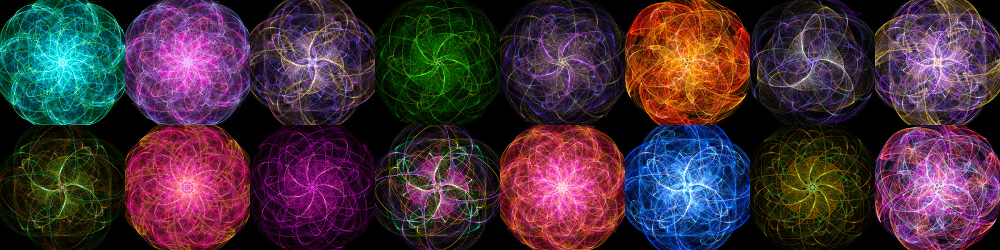
